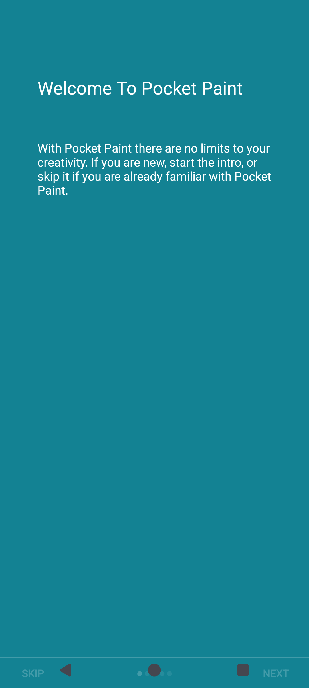
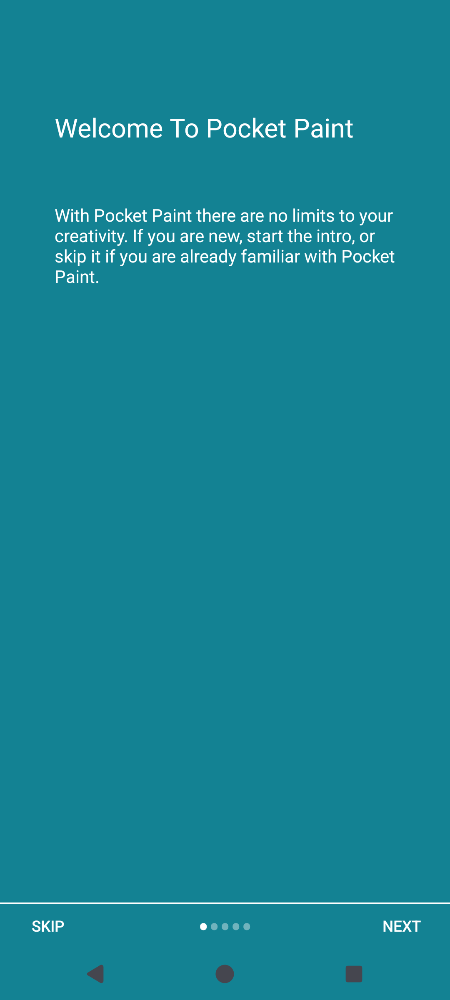

# CATROID-1677: Paintroid tutorial navigation

Validated on 2026-11-07. Existing Jira ticket: https://catrobat.atlassian.net/browse/CATROID-1677

## Change

The welcome activity applies left, right and bottom system-window insets to its root layout. Its existing bottom navigation, divider and pager therefore remain above Android's navigation area. Original padding is captured once, so repeated inset dispatch does not accumulate padding. This uses the AndroidX Core API already available in the project, without changing dependencies or the host's window configuration.

Source base: Catrobat/Paintroid develop at 3bd38900dd008f90f8ec6d5e6515a238bf7b5128.

## Before and after

Android 15, 1080 x 2400, three-button navigation. Android's navigation bar starts at y=2274.

* Before: Next and Skip occupied y=2295..2400, underneath system navigation. A real tap at the Next button center did not advance the tutorial. Screenshot captured from Paintroid embedded in the isolated Pocket Code 1.4.2 test APK, package org.catrobat.catroid.independent_pr5270 (target SDK 36).
* After: Next and Skip occupy y=2169..2274. A real tap at Next advances to More possibilities. Screenshot captured from the rebuilt standalone debug app through its Help menu.

| Embedded Catroid before fix | Standalone Paintroid after fix |
| --- | --- |
|  |  |

## Automated verification

* Regression test on unmodified production sources: FAIL as expected, `Tutorial button overlaps system navigation: Rect(849, 2295 - 1080, 2400), navigation top 2274`.
* Android 15 / API 35, three-button navigation: all 7 IntroIntegrationTest tests pass, including the new geometry assertion and existing real input tests for Next, Skip and Let's go.
* Android 15 / API 35, gesture navigation: all 7 tutorial tests pass.
* Paintroid unit tests: 257 tests, 0 failures.
* Android lint (`:Paintroid:lintDebug`): passes.
* `git diff --check`: passes.

Commands (Java 21, installed Android SDK):

```text
./gradlew :Paintroid:connectedDebugAndroidTest -Pandroid.testInstrumentationRunnerArguments.class=org.catrobat.paintroid.test.espresso.intro.IntroIntegrationTest
./gradlew :Paintroid:testDebugUnitTest :Paintroid:lintDebug
```

The gesture-mode suite was also run directly with `adb shell am instrument -w -e class org.catrobat.paintroid.test.espresso.intro.IntroIntegrationTest org.catrobat.paintroid.test/androidx.test.runner.AndroidJUnitRunner` after selecting the gesture navigation overlay.

## Check limitation

The repository's unmodified Detekt task fails before source analysis with `Invalid value passed to --jvm-target` under Java 21. A temporary JVM 17 task override then exposes a CLI/plugin incompatibility: `Was passed main parameter '--jdk-home' but no main parameter was defined in your arg class`. No build configuration changes are included in this branch.

## Jira and existing PRs

CATROID-1677 is an exact match, unresolved, so no duplicate ticket was created. PAINTROID-809 describes the same symptom in the separate Flutter app and is marked merged. No PR referencing CATROID-1677 was found. Historical Paintroid PR 442 adjusts the dots/buttons layout and contains no system-navigation inset handling.
## Catroid integration verification

Built an isolated Catroid test APK from wslany/Catroid hotfix/catroid-1.4.2-media-picker at aacd0d5, replacing only the bundled Paintroid and Colorpicker AARs in the temporary checkout with the newly built develop debug AARs. No Catroid changes were published.

```text
./gradlew assembleCatroidDebug -Pindependent="Paintroid tutorial test" -PindependentPackageSuffix=tutorial_insets
```

Build passes. Installed package: org.catrobat.catroid.independent_tutorial_insets. The embedded Paintroid MainActivity was launched directly, then Help opened through the UI (debug AARs do not automatically show the first-install tutorial). This exercises the real tutorial activity within the Catroid host, while avoiding the unrelated Catroid onboarding flow.

On API 35 with three-button navigation, both tutorial buttons occupy y=2169..2274, above system navigation. A real Next tap advances to More possibilities; a real Skip tap closes WelcomeActivity and returns to the embedded MainActivity.



## Android 14 compatibility attempt

The existing API 34 AVD repeatedly lost test-window focus to unrelated launcher and System UI ANR dialogs. A clean disposable API 34 AVD also failed to become usable during this session (ADB stayed offline). These attempts do not establish a pass or a Paintroid regression on Android 14. API 34 compatibility remains unverified; only the API 35 results above are claimed.